

  
  
  
  

# Portland.HODL: Bitcoin Developer, Bitcoin Core Contributor & Hardware Hacker

I'm a **Bitcoin developer** and **Bitcoin Core contributor**. I build open-source **Bitcoin tools** that run entirely in your browser:
**Miniscript** and **output descriptor** designers, a **Bitcoin Script debugger**, **Taproot** pay-to-contract policies, **zero-knowledge
BIP32 xpub proofs**, and a full **Bitcoin Core node compiled to WebAssembly**, running on **v86_64**, my x86-64 emulator that boots 64-bit Linux in the browser. Most are written in **Rust** and shipped as **WASM**, so nothing
leaves your machine. On the hardware side I designed **Nyan Keys**, the first true USB 2.0 High Speed **FPGA mechanical keyboard**, and I
founded **[QR Snap](https://qrsnap.io)**, a dynamic QR code and analytics platform.

 

<a href="https://portlandhodl.github.io/v86_64/">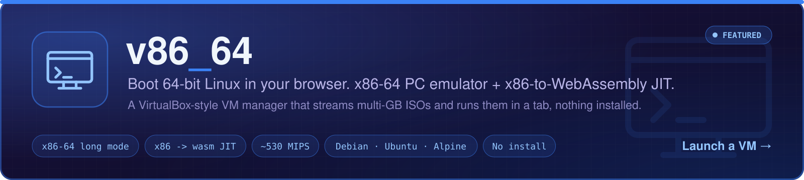</a>

  <a href="https://portlandhodl.github.io/v86_64/"><b>Launch v86_64</b></a> · <a href="https://github.com/portlandhodl/v86_64">source</a>

**[v86_64](https://github.com/portlandhodl/v86_64)** is an **x86-64 PC emulator** and **x86-to-WebAssembly JIT** that boots unmodified
**64-bit (long mode)** operating systems in a browser tab: 64-bit Linux kernels, 64-bit userspace and full desktop distributions, with
nothing installed. Multi-GB ISOs stream on demand over HTTP range requests into a VirtualBox-style VM manager, and hot 64-bit code is
compiled to wasm (~530 MIPS vs ~80 interpreted). It began as a 64-bit fork of [v86](https://github.com/copy/v86) and also powers
[WASM Bitcoin Tools](https://portlandhodl.github.io/wasm-bitcoin-tools/).

<table>
<tr>
<td width="50%" valign="top">

<b>Debian Live (testing), Xfce</b>: 4.4 GB live ISO, 1024x768x32
</td>
<td width="50%" valign="top">

<b>Ubuntu 26.04.1 LTS Desktop</b>: 6.5 GB ISO streamed with range requests
</td>
</tr>
</table>

 

Free, open-source, client-side **Bitcoin developer tools**. No accounts, no servers, no keys leaving your browser.

<table>
<tr>
<td width="50%" valign="top">
<a href="https://gpupairs.com">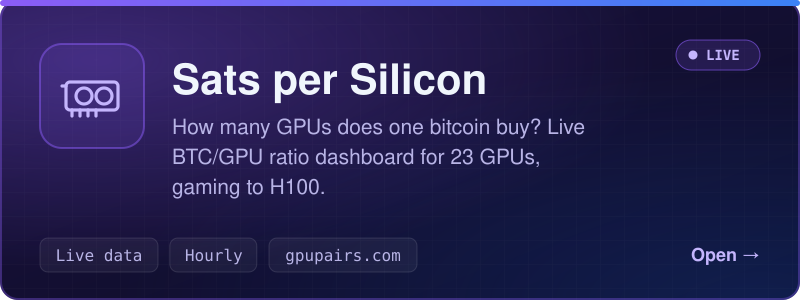</a>
<b><a href="https://gpupairs.com">Sats per Silicon</a></b> · <a href="https://github.com/portlandhodl/btcgpus">source</a> 
How many GPUs does 1 BTC buy? A live <b>bitcoin vs GPU price</b> tracker for RTX 5090, RX 9070 XT, H100, H200, MI300X and DGX Spark, with sats per GPU, eBay sold prices and cloud GPU-hours per BTC.
</td>
<td width="50%" valign="top">
<a href="https://portlandhodl.github.io/miniscript-studio/">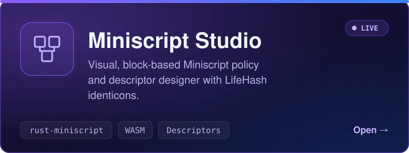</a>
<b><a href="https://portlandhodl.github.io/miniscript-studio/">Miniscript Studio</a></b> · <a href="https://github.com/portlandhodl/miniscript-studio">source</a> 
Block-based <b>Bitcoin Miniscript policy</b> and <b>descriptor designer</b> for multisig and timelocked wallets. rust-miniscript in WASM.
</td>
</tr>
<tr>
<td width="50%" valign="top">
<a href="https://portlandhodl.github.io/xproof/">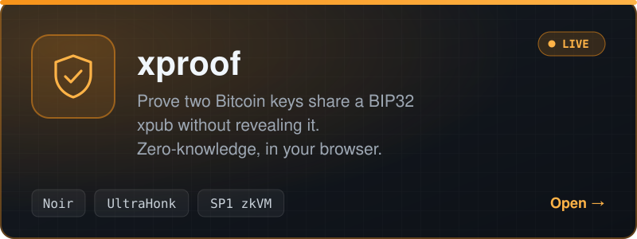</a>
<b><a href="https://portlandhodl.github.io/xproof/">xproof</a></b> · <a href="https://github.com/portlandhodl/xproof">source</a> 
A <b>zero-knowledge proof</b> that two Bitcoin public keys derive from the same <b>BIP32 extended public key</b>, without revealing the xpub. Noir / UltraHonk in the browser, or the SP1 zkVM.
</td>
<td width="50%" valign="top">
<a href="https://portlandhodl.github.io/wasm-bitcoin-tools/">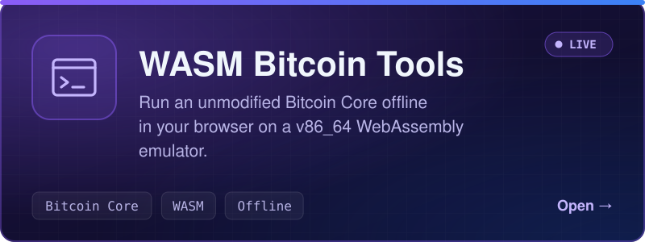</a>
<b><a href="https://portlandhodl.github.io/wasm-bitcoin-tools/">WASM Bitcoin Tools</a></b> · <a href="https://github.com/portlandhodl/wasm-bitcoin-tools">source</a> 
Run <b>bitcoind and bitcoin-cli in the browser</b>: an unmodified Bitcoin Core on the v86_64 WebAssembly x86 emulator, fully offline.
</td>
</tr>
<tr>
<td width="50%" valign="top">
<a href="https://portlandhodl.github.io/btcdeb-wasm/">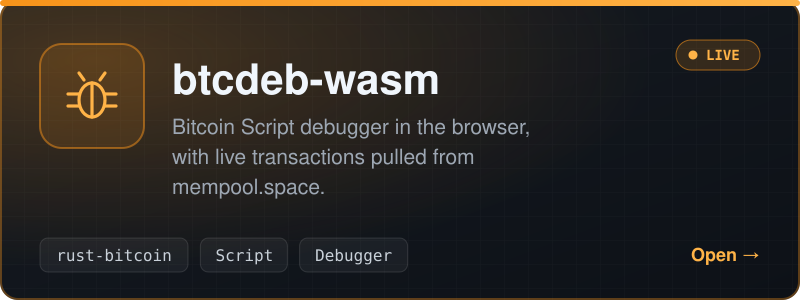</a>
<b><a href="https://portlandhodl.github.io/btcdeb-wasm/">btcdeb-wasm</a></b> · <a href="https://github.com/portlandhodl/btcdeb-wasm">source</a> 
Step through <b>Bitcoin Script</b> opcode by opcode, inspect the stack, and load real transactions from mempool.space. rust-bitcoin compiled to WebAssembly.
</td>
<td width="50%" valign="top">
<a href="https://portlandhodl.github.io/north-pol/">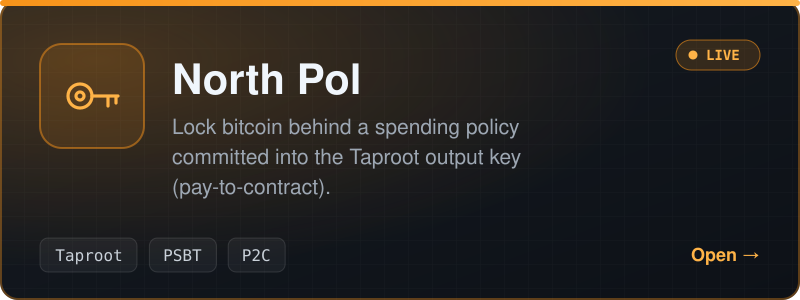</a>
<b><a href="https://portlandhodl.github.io/north-pol/">North Pol</a></b> · <a href="https://github.com/portlandhodl/north-pol">source</a> 
Commit a spending policy into a <b>Taproot output key</b> (pay-to-contract) and verify it from a <b>PSBT</b> proprietary field. Runs entirely in-browser.
</td>
</tr>
<tr>
<td width="50%" valign="top">
<a href="https://portlandhodl.github.io/miniscript-ast-viewer/">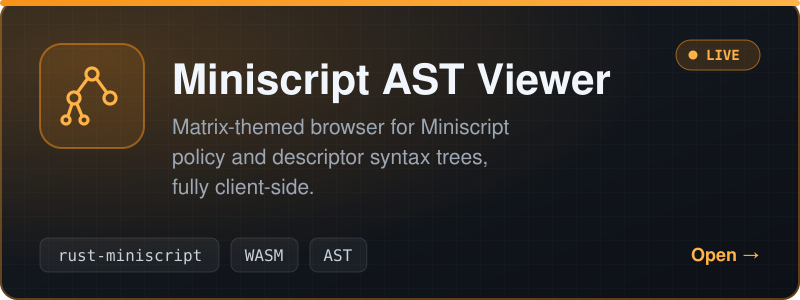</a>
<b><a href="https://portlandhodl.github.io/miniscript-ast-viewer/">Miniscript AST Viewer</a></b> · <a href="https://github.com/portlandhodl/miniscript-ast-viewer">source</a> 
Explore the <b>abstract syntax tree</b> of any Miniscript policy or descriptor,. Also see <a href="https://portlandhodl.github.io/minisite/">Minisite</a>, a quick Miniscript analyzer.
</td>
<td width="50%" valign="top">
<a href="https://portlandhodl.github.io/descriptor-forge/">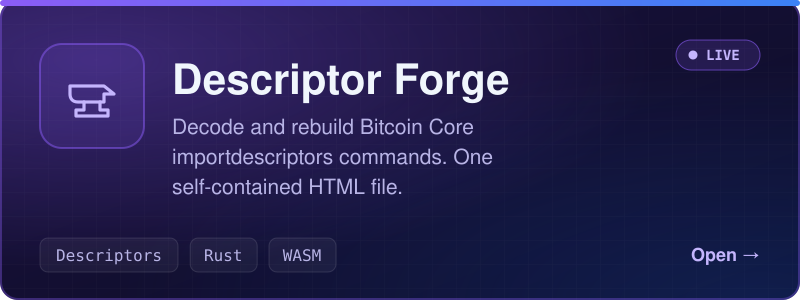</a>
<b><a href="https://portlandhodl.github.io/descriptor-forge/">Descriptor Forge</a></b> · <a href="https://github.com/portlandhodl/descriptor-forge">source</a> 
Decode, edit and rebuild <b>Bitcoin Core importdescriptors</b> RPC commands. One self-contained HTML file.
</td>
</tr>
</table>

 

| | Project | What it does |
|:-:|---|---|
| 🦀 | **[rust-bitcoin-core-miniscript-ffi](https://github.com/portlandhodl/rust-bitcoin-core-miniscript-ffi)** | Rust FFI bindings to **Bitcoin Core's Miniscript** implementation |
| 📐 | **[miniscript-lean](https://github.com/portlandhodl/miniscript-lean)** | **Lean 4 formal verification** of Miniscript (BIP-379): Bitcoin Core vs rust-miniscript type systems, with divergence theorems |
| 🐟 | **[windfish](https://github.com/portlandhodl/windfish)** | Serde library for **Bitcoin Core mempool.dat** dumps |
| 🔐 | **[coldcard_fw_dicerolls_trace](https://github.com/portlandhodl/coldcard_fw_dicerolls_trace)** | Full trace of the **COLDCARD hardware wallet dice-roll** seed path on production firmware |
| 🧊 | **[rust-ckcc-protocol](https://github.com/portlandhodl/rust-ckcc-protocol)** | Rust port of the COLDCARD **ckcc-protocol** USB library and CLI |
| 💼 | **[wallet-dot-dat-js](https://github.com/portlandhodl/wallet-dot-dat-js)** | Byte-exact **Bitcoin Core wallet.dat** (SQLite descriptor wallet) exporter in zero-dependency JavaScript |
| 🖼️ | **[no_tread_on_bytes](https://github.com/portlandhodl/no_tread_on_bytes)** | Bitcoin **Script Push Media** codec in Rust, Python and WASM |
| 🍌 | **[banana-pay-server](https://github.com/portlandhodl/banana-pay-server)** | Caveman-themed, BTCPay-inspired **Bitcoin payment server** in Rust |
| 🐢 | **[lazy-bitcoin-wallet](https://github.com/portlandhodl/lazy-bitcoin-wallet)** · **[trucr](https://github.com/portlandhodl/trucr)** | Fee-lazy wallets built on **v3 TRUC transactions** with BDK and Bitcoin Core |
| 🌲 | **[cerkle-tree](https://github.com/portlandhodl/cerkle-tree)** | High-performance **sparse Merkle tree** library in C++ |
| 🔭 | **[bipstream](https://github.com/portlandhodl/bipstream)** | Live fork observer for **Bitcoin Core vs Bitcoin Knots** |
| 📡 | **[node_policy_viz](https://github.com/portlandhodl/node_policy_viz)** · **[electrs_benchmark](https://github.com/portlandhodl/electrs_benchmark)** | Node relay-policy propagation visualizer, and an **Electrum / electrs** server benchmark |
| 🧪 | **[jade-docker-web-server](https://github.com/portlandhodl/jade-docker-web-server)** | Docker image of the **Blockstream Jade** firmware for testing and CI |
| 🧩 | **[bitcoin-script-hints-vscode](https://github.com/portlandhodl/bitcoin-script-hints-vscode)** | **VS Code extension** port of bitcoin-script-hints.nvim for Bitcoin Script |
| 📜 | **[BitCoin-0.01](https://github.com/portlandhodl/BitCoin-0.01)** | Source of the **original Bitcoin v0.1** client release (Jan 9, 2009) |

 

<table>
<tr>
<td width="50%" valign="top">
<a href="https://github.com/portlandhodl/nyan-keys-hardware">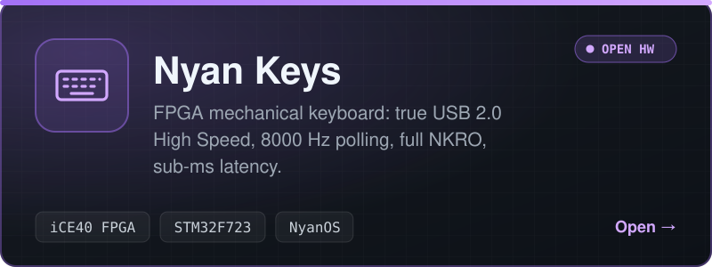</a>
<b><a href="https://github.com/portlandhodl/nyan-keys-hardware">Nyan Keys</a></b>: an open-source <b>FPGA mechanical keyboard</b>. The first true USB 2.0 <b>High Speed</b> (not Full Speed) keyboard, with native <b>8000 Hz polling</b> and full NKRO in every report, no drivers needed. Each key is scanned in parallel by the FPGA for <b>sub-millisecond latency</b>.
</td>
<td width="50%" valign="top">

**Nyan Keys repos**
- [Hardware design files (KiCad)](https://github.com/portlandhodl/nyan-keys-hardware)
- [iCE40 HX4K FPGA bitstream (Verilog)](https://github.com/portlandhodl/nyan-keys-ice40hx4k-bitstream)
- [NyanOS STM32F723 firmware](https://github.com/portlandhodl/nyan-keys-stm32-firmware)
- [USB 2.0 HS DFU bootloader](https://github.com/portlandhodl/nyan-keys-dfu-bootloader)
- [NyanOS WebSerial config GUI](https://github.com/portlandhodl/nyan-keys-gui) · [hosted](https://portlandhodl.github.io/)
- [Original r/FPGA post](https://www.reddit.com/r/FPGA/comments/17rt1rc/a_little_side_project_of_mine_fpga_based)

**More hardware**
- [bitclock](https://github.com/portlandhodl/bitclock): MIT firmware for **ESP32 e-paper Bitcoin tickers**
- [LTC2983 Node.js driver](https://github.com/portlandhodl/LTC2983_NODEJS_RASPI) for Raspberry Pi temperature sensing
- [Tri-Mode MAC to AXI buffer](https://github.com/portlandhodl/Tri-Mode-MAC-to-AXI-Buffer) · [FPGA Sobel filter](https://github.com/portlandhodl/fpga_sobel)

</td>
</tr>
</table>

 

<table>
<tr>
<td width="50%" valign="top">
<a href="https://qrsnap.io">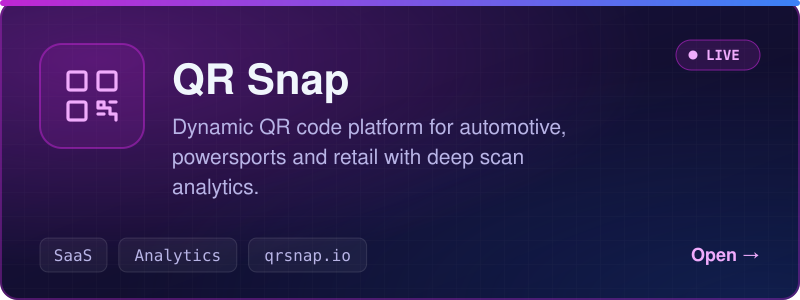</a>
<b><a href="https://qrsnap.io">QR Snap</a></b>: <b>dynamic QR codes</b> with scan analytics for automotive and powersports dealers and retail.
</td>
<td width="50%" valign="top">
<a href="https://portlandhodl.github.io/inkwell/">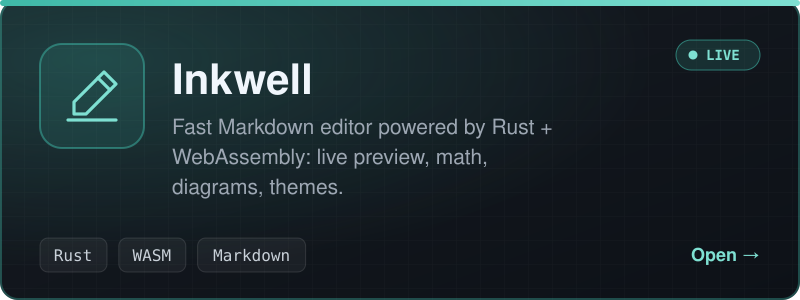</a>
<b><a href="https://portlandhodl.github.io/inkwell/">Inkwell</a></b> · <a href="https://github.com/portlandhodl/inkwell">source</a>: a fast <b>Markdown editor</b> in Rust + WebAssembly with math, diagrams and themes.
</td>
</tr>
</table>

| | Project | What it does |
|:-:|---|---|
| 🚀 | **[cargo-remote](https://github.com/portlandhodl/cargo-remote)** | **Compile Rust on a remote server** over pure-Rust SSH with incremental delta sync |
| 🎮 | **[gc-rust](https://github.com/portlandhodl/gc-rust)** | Write **Nintendo GameCube homebrew in Rust** (custom target, `gc-std`, GX 3D) |
| 🕹️ | **[wasm-gpc-mp](https://github.com/portlandhodl/wasm-gpc-mp)** | Deterministic **Game Boy Color emulator in Rust/WASM** with multiplayer sync |
| 👾 | **[rgba](https://github.com/portlandhodl/rgba)** | Rust port of the **mGBA** Game Boy Advance emulator |
| 🐱 | **[kitr](https://github.com/portlandhodl/kitr)** | Rust rewrite of the **kitty terminal emulator** |
| 🔑 | **[ykchat](https://github.com/portlandhodl/ykchat)** | Video chat with continuous **YubiKey** presence proofs |

 

<table>
<tr>
<td width="50%" valign="top">
<a href="https://github.com/portlandhodl/bitcoin-bootcamp">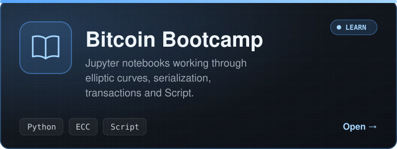</a>
</td>
<td width="50%" valign="top">

- **[Bitcoin Bootcamp](https://github.com/portlandhodl/bitcoin-bootcamp)**: learn **elliptic curve cryptography**, serialization, transactions and **Bitcoin Script** in Jupyter
- **[BIPs education series](https://github.com/portlandhodl/bips_education_series)**: lecture materials from my **Bitcoin Improvement Proposal** Twitter Spaces
- **[Basic Bitcoin tech](https://github.com/portlandhodl/basic_bitcoin_tech)**: introductory Bitcoin technology slideshows

</td>
</tr>
</table>

 

| Project | Merged PRs |
|---|---|
| **[bitcoin/bitcoin](https://github.com/bitcoin/bitcoin/pulls?q=is%3Apr+author%3Aportlandhodl+is%3Amerged)** (Bitcoin Core) |  |
| **[bitcoin/bips](https://github.com/bitcoin/bips/pulls?q=is%3Apr+author%3Aportlandhodl+is%3Amerged)** |  |
| **[rust-bitcoin](https://github.com/rust-bitcoin/rust-bitcoin/pulls?q=is%3Apr+author%3Aportlandhodl+is%3Amerged)** |  |
| **[rust-miniscript](https://github.com/rust-bitcoin/rust-miniscript/pulls?q=is%3Apr+author%3Aportlandhodl+is%3Amerged)** |  |
| **[mempool/mempool](https://github.com/mempool/mempool/pulls?q=is%3Apr+author%3Aportlandhodl+is%3Amerged)** (mempool.space) |  |

 

### Get in touch

Topics: x86-64 emulator · Bitcoin · Bitcoin Core · Miniscript · output descriptors · PSBT · Taproot · BIP32 · zero-knowledge proofs · Rust · WebAssembly · FPGA · mechanical keyboards · hardware wallets · COLDCARD · Lean 4 formal verification

Banners are generated by [`scripts/make_banners.py`](scripts/make_banners.py).
